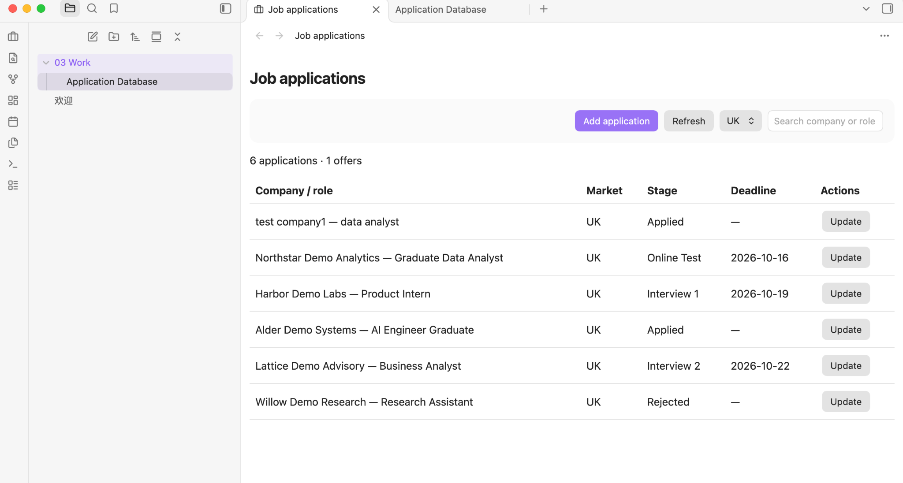

# Application Flow

Track job applications, recruitment stages, deadlines, and preparation notes in Obsidian. Free and open source, with English and Chinese interfaces. No QuickAdd or Dataview dependency.

在 Obsidian 中记录投递、招聘阶段、截止日期和准备笔记。免费开源，支持中英文界面，无需 QuickAdd 或 Dataview。

[Community listing](https://community.obsidian.md/plugins/dgracy-application-flow)

## Add an application

1. Open the command palette: **⌘ P** on Mac, **Ctrl P** on Windows or Linux.
2. Search **Application Flow: Add application** and press **Enter**.
3. Choose a market, fill in the company, role, application date, and stage, then save.
4. Expand **More information** for optional fields. Enable **Create preparation note** to keep the job description and requirements.

## 新增申请

1. Mac 按 **⌘ P**，Windows 或 Linux 按 **Ctrl P**，打开命令面板。
2. 搜索 **新增申请**，按回车。
3. 选择市场，填写公司、岗位、申请日期和招聘阶段，保存即可。
4. 其他内容在「更多信息」里补充；需要保留 JD 和岗位要求时，开启「创建准备笔记」。


## Dashboard

Close the application form with **Esc**, then click the **briefcase icon in the left ribbon**. Search or filter your records, and click **Update** to change stages, deadlines, and history notes.

You can also use the command **Application Flow: Open dashboard / update application**. The dashboard opens as a tab, not a file in your vault.

## 求职总览

按 **Esc** 关闭申请表单，点击左侧工具栏的 **公文包图标**。在总览里搜索或筛选申请，点击「更新」修改招聘阶段、截止日期和流程备注。

也可以通过命令面板搜索「打开总览／更新申请」。总览是独立标签页，不会在文件列表中生成笔记。



*Fictional demo data. In version 1.2.0, the application count follows the filter; the offer count covers the whole database.*

*截图使用虚构演示数据。1.2.0 的申请数量跟随筛选条件，录用数量统计整个数据库。*

## Settings

Under **Settings → Application Flow**, choose your interface language, database file, and preparation notes folder. Language changes leave existing records untouched; reopen an application form to see the new language.

Assign direct shortcuts under **Settings → Hotkeys** by searching for **Application Flow**.

## 设置

在「设置 → Application Flow」中选择界面语言、数据库文件和准备笔记目录。切换语言不会改写已有记录；已经打开的申请表单需重新打开。

需要一键新增或打开总览，可在「设置 → 快捷键」中搜索 **Application Flow**，自行绑定按键。

## Demo

[Download the demo database](docs/demo/Application-Database-Demo.md), place it at the root of a test vault, and set the database path to `Application-Database-Demo.md`. It contains 12 fictional applications. Switch back to your original database path when finished.

把[演示数据库](docs/demo/Application-Database-Demo.md)放在测试仓库根目录，将数据库路径设为 `Application-Database-Demo.md`，即可查看 12 条虚构申请。体验后改回原路径即可。

## Project details

- [Advanced setup and migration](docs/advanced-setup.md)
- [Data model](docs/data-model.md)
- [Original QuickAdd and Dataview workflow](docs/original-workflow.md)
- [GitHub Releases](https://github.com/DGracy/obsidian-job-application-system/releases)
- [MIT License](LICENSE)

Build and validate with Node.js 22 or newer:

```sh
npm run check
npm run build
npm test
```

Data stays in your vault; the plugin uses no telemetry or external services. Automated tests cover data operations and mocked UI interactions. Mobile testing remains pending.
