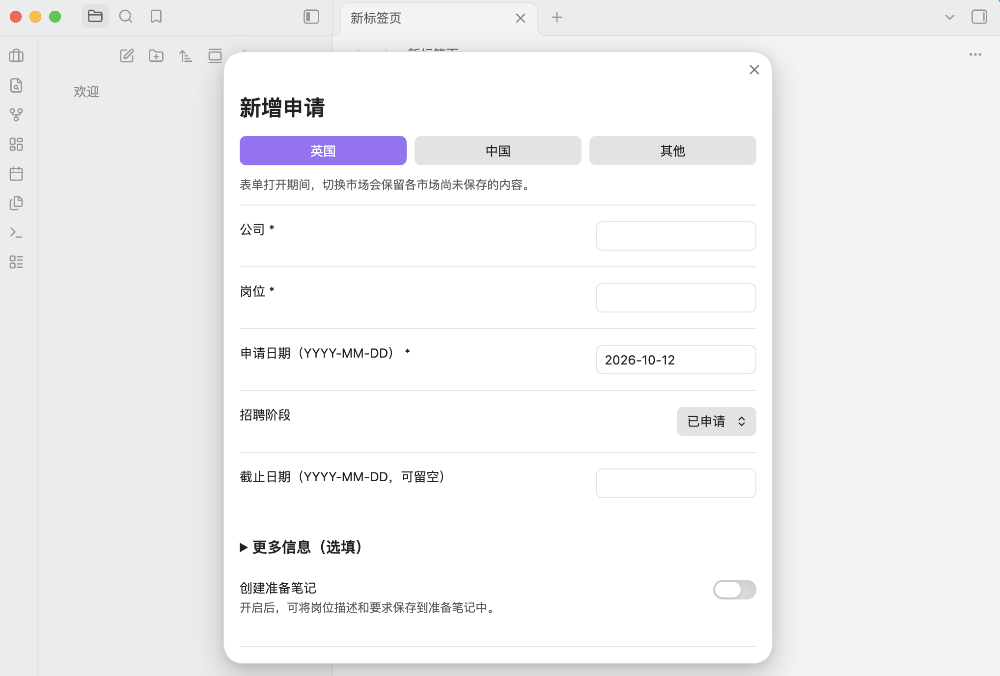
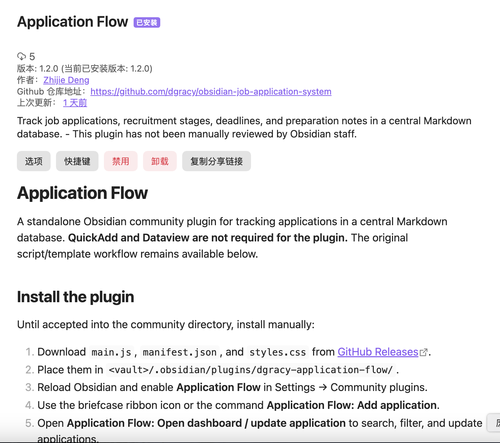
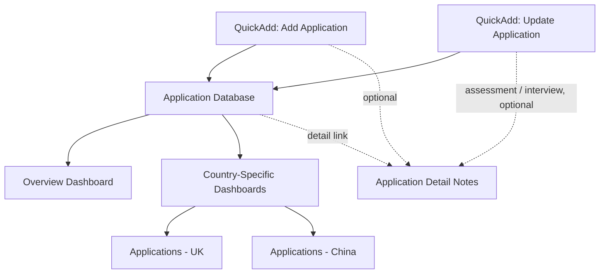

# Application Flow

A standalone Obsidian community plugin for tracking applications in a central Markdown database. **QuickAdd and Dataview are not required for the plugin.** The original script/template workflow remains available below.

## Install the plugin / 安装插件

Application Flow is available in the [Obsidian Community directory](https://community.obsidian.md/plugins/dgracy-application-flow). You can install it directly inside Obsidian; no manual GitHub download is needed.

1. Open **Settings → Community plugins → Browse** (turn off Restricted mode if prompted).
2. Search for **Application Flow** and confirm the author is **Zhijie Deng**.
3. Click **Install**, then **Enable**.
4. Open **Settings → Application Flow → Interface language** to choose **English** or **中文**.
5. Click the briefcase ribbon icon, or use the command **Application Flow: Add application**. Open **Application Flow: Open dashboard / update application** to search, filter, and update applications.

中文安装步骤：

1. 打开 **设置 → 社区插件 → 浏览**；如有提示，先关闭受限模式。
2. 搜索 **Application Flow**，确认作者为 **Zhijie Deng**。
3. 点击 **安装**，然后点击 **启用**。
4. 在 **设置 → Application Flow → 界面语言** 中选择中文或 English。
5. 点击侧栏公文包图标，或在命令面板中使用「新增申请」「打开总览／更新申请」。

**QuickAdd and Dataview are not required. 无需额外安装 QuickAdd 或 Dataview。**

<details>
<summary>Manual installation (alternative) / 手动安装（备用方式）</summary>

1. Download `main.js`, `manifest.json`, and `styles.css` from [GitHub Releases](https://github.com/DGracy/obsidian-job-application-system/releases).
2. Place them in `<vault>/.obsidian/plugins/dgracy-application-flow/`.
3. Reload Obsidian and enable **Application Flow** in Settings → Community plugins.
4. When replacing an existing manual installation, preserve `data.json` if present to retain your settings.

</details>

## Quick start / 快速开始

### Add a new application / 新增投递记录

The plugin does not assign a default direct shortcut for adding an application. Use Obsidian's command palette:

| Computer / 电脑 | Open command palette / 打开命令面板 |
| --- | --- |
| Mac | `⌘ Command + P` |
| Windows / Linux | `Ctrl + P` |

1. Press the keys above.
2. Search for **Application Flow: Add application** (English interface) or **Application Flow: 新增申请** (中文界面).
3. Press **Enter / 回车** to open the application form.
4. Choose **UK / China / Other**; enter the company, role, and application date, then select the recruitment stage.
5. Expand **More information / 更多信息** for role type, source, job URL, CV version, and other optional fields.
6. Enable **Create preparation note / 创建准备笔记** if you want to save the JD and requirements.
7. Click **Save / 保存**. The record is saved to the configured Markdown database.



中文：Mac 按 **⌘ P**，Windows／Linux 按 **Ctrl P**，搜索 **新增申请**，按回车即可打开投递表单。填写后点击 **保存**。

### Open the dashboard / 查看和更新申请

The dashboard is a plugin view, not a Markdown note. It does not create a file called “Dashboard” or “求职面板” in the file list. Even one or two saved applications can be displayed.

1. If the **Add application** form is open, press **Esc** or click its close button.
2. Click the **briefcase icon in the left ribbon**.
3. The **Job applications** view opens, with Add application, Refresh, market filters, a search box, and the application table.
4. To open it from the command palette instead, press **⌘ P** on Mac or **Ctrl P** on Windows/Linux, search for **Application Flow: Open dashboard / update application**, then press **Enter**.
5. Click **Update** beside an application to change its recruitment stage, deadline, and history note.

中文操作：

1. 如果「新增申请」窗口还开着，按 **Esc** 或点击关闭按钮。
2. 点击 **最左侧工具栏的公文包图标**。
3. 打开标题为 **「求职申请」** 的总览，里面有 **新增申请、刷新、市场筛选、搜索框和申请表格**。
4. 也可以按 **⌘ P（Mac）／Ctrl P（Windows、Linux）**，搜索 **「打开总览／更新申请」**，按回车打开。
5. 点击某条申请旁的 **「更新」**，修改招聘阶段、截止日期和流程备注。

**总览是插件视图，不会在文件列表里生成一篇「求职面板」笔记；只有一两条申请也能展示。**

If saved records are not visible, select **All / 全部**, clear the search box, and click **Refresh / 刷新**. Also check **Settings → Application Flow → Database file / 数据库文件** points to the file where your applications were saved.

### Try the dashboard with fictional data / 使用虚构数据体验总览

Download [Application-Database-Demo.md](docs/demo/Application-Database-Demo.md), put it anywhere in your **test vault**, then set **Settings → Application Flow → Database file** to its vault-relative path (for example `Application-Database-Demo.md` if saved at the vault root). Apply the setting and open or refresh the dashboard.

The file contains 12 fictional applications across UK, China, Germany and Singapore, covering all eight recruitment stages. The dashboard shows 12 applications and 1 offer. It does not contain real applications. Keep your original database separate; changing the setting does not overwrite it.

中文：把示例文件放在测试 vault 的根目录，在「设置 → Application Flow → 数据库文件」填写 `Application-Database-Demo.md`，点击「应用」，然后打开或刷新总览，即可显示 12 条演示申请。切回原来的数据库路径即可恢复真实记录视图。

### Set your own direct shortcuts / 自定义一键快捷键

Open **Settings → Hotkeys / 设置 → 快捷键**, search for **Application Flow**, and assign a shortcut to **Add application / 新增申请** or **Open dashboard / update application / 打开总览／更新申请**.

Choose a combination that Obsidian does not mark as conflicting. These direct shortcuts are user-configured; `⌘ P` / `Ctrl P` opens the command palette rather than the form itself.

### Community plugin page / 社区插件页面

The actual Obsidian listing below shows the installed plugin and its author. For a new installation, use **Install / 安装** and then **Enable / 启用**. Once installed, **Options / 选项** opens the plugin settings and **Hotkeys / 快捷键** opens shortcut configuration.



Settings let you choose the Markdown database file and preparation notes folder. Defaults match the original workflow. Existing records are read without importing, copying, or replacing the database. Initialization happens only when saving an application, not when enabling the plugin. Changing settings does not move existing files.

The new form can save a job description and requirements to an optional preparation note. Enable the preparation-note toggle when adding or updating a role. Dates use `YYYY-MM-DD`; clear the deadline field to remove the old deadline. Exact duplicate market/company/role/application-date entries are rejected. Other markets use an `OTHER` ID prefix.

The Add application form has UK, China, and Other tabs with independent drafts. Sponsorship is shown and saved only for UK. Other requires a country/region name, stored as the actual market. Role type and source accept custom text and offer market-specific suggestions plus values from your existing records. More information is collapsed initially; JD and requirements are shown only when preparation notes are enabled. Closing the form discards unsaved drafts.

## Upgrade from 1.0.0 or 1.1.0

The old ID `job-application-tracker` conflicts with another community plugin. Version 1.1.1 uses `dgracy-application-flow` and the name Application Flow.

1. Disable the old **Job Application Tracker** entry whose author is **Zhijie Deng**. Do not install or update the unrelated community entry.
2. Quit Obsidian. Rename your manually installed `.obsidian/plugins/job-application-tracker/` folder to `.obsidian/plugins/dgracy-application-flow/`.
3. Replace `main.js`, `manifest.json`, and `styles.css` with the latest release assets. Preserve `data.json` if present; it contains your configured paths.
4. Reopen Obsidian and enable **Application Flow**. Check your database path in settings.

Application records and preparation notes do not need migration. If you intentionally installed the other author's plugin too, keep it in its own folder and install Application Flow separately.

## Language / 语言

In Settings → Application Flow → Interface language, choose **English** or **中文**. The selection is saved for this vault. Settings and dashboards update immediately; reopen an already-open application form to see the chosen language.

在「设置 → Application Flow → 界面语言」选择中文或 English。语言选择会保存在当前仓库中。表单、按钮、招聘阶段、总览和提示支持双语；新建准备笔记的标题使用当前语言。

Language changes translate the interface, not user-entered text or existing notes. Stored market/status/priority values and metadata keys remain stable for compatibility with existing dashboards and scripts. Free-text role/source suggestions retain their original wording.

## Development and validation

Node.js 22 or newer; no npm dependencies are required.

```sh
npm run check
npm run build
npm test
```

`src/plugin.js` uses the Obsidian runtime API. `src/model.js` contains Markdown data operations. `build.js` bundles both into `main.js`; commit the generated file alongside source changes. The release workflow validates the bundle and publishes a GitHub Release only when the manifest version has no existing release. Increment `manifest.json`, `package.json`, and `versions.json` for subsequent releases.

Automated checks cover the data model and mocked plugin loading. Real Obsidian desktop/mobile interface testing is still required. `isDesktopOnly: false` indicates that the implementation avoids desktop-only APIs; it does not claim completed mobile testing. Back up your database before first use.

No telemetry, network requests, or external services are used by the plugin. Application data stays in your vault. Original fictional examples remain unchanged.

---

## Original QuickAdd / Dataview workflow

# Application Flow for Obsidian

A metadata-driven job application workflow built with **Obsidian**, **QuickAdd**, **Dataview**, and **JavaScript**.

The system is designed for high-volume job application tracking without creating a separate note for every application. A central application database stores structured metadata and recruitment status, while dedicated detail notes are created only for high-priority roles, assessments, interviews, or applications that require deeper preparation.

## What it does

- Unified application entry workflow with country-specific fields, demonstrated for the UK and China
- Stable application IDs for reliable updates
- Duplicate-application warning
- Recruitment-stage and deadline tracking
- Automatic process-history logging
- Optional application detail pages
- Automatic detail-page creation when an application reaches assessment/interview stages
- Priority, career-track, source, sponsorship, and CV-version metadata
- Real-time overview and country-specific dashboards powered by Dataview
- Separation between structured tracking data and deeper application research

## Architecture



The Application Database is the single source of truth for status and deadlines.

The country-specific dashboards are filtered views built on top of the same data model. The UK and China dashboards in this repository are example implementations, and the same structure can be extended to other countries or regions.

Application detail notes are optional and deliberately do **not** duplicate live recruitment status.

## Repository layout

```text
03 Work/
├── Application Database.md
└── Job Search/
    ├── 00 Dashboard/
    │   ├── Overview.md
    │   ├── Applications - UK.md
    │   └── Applications - China.md
    ├── 01 Applications/
    └── 02 Scripts/
        ├── add-application.js
        └── update-application.js
```

All application data in this repository is fictional demo data.

## Requirements

Install these Obsidian community plugins:

- **QuickAdd** — runs the add/update JavaScript workflows
- **Dataview** — renders dashboards and KPI views

Dataview JavaScript queries must be enabled for the Overview dashboard.

## Setup

1. Copy `example-vault/03 Work/` into your Obsidian vault, or reproduce the same folder structure.
2. In QuickAdd, create a Macro/User Script command for:
   - `03 Work/Job Search/02 Scripts/add-application.js`
   - `03 Work/Job Search/02 Scripts/update-application.js`
3. Open `03 Work/Job Search/00 Dashboard/Overview.md`.
4. Replace the fictional records in `03 Work/Application Database.md` with your own data.

The default script paths are intentionally centralized at the top of each script so they can be changed if your vault uses a different folder structure.

## Core data model

Each application has stable parent-level metadata:

```markdown
- **Northstar Analytics — Graduate Data Analyst**
  [id:: UK-20260910-01]
  [country:: UK]
  [company:: Northstar Analytics]
  [role:: Graduate Data Analyst]
  [type:: Graduate Scheme]
  [sponsor:: Unknown]
  [source:: Company Website]
  [applied:: 2026-09-10]
  [track:: Data / Analytics]
  [priority:: High]
  [cv_version:: Data]
  [detail:: [[03 Work/Job Search/01 Applications/2026-09-10 - Northstar Analytics - Graduate Data Analyst]]]
    - 🔄 [status:: Online Test] [deadline:: 2026-09-28]
```

Dynamic recruitment information lives on the child status row. This makes status updates safe while keeping the parent metadata stable.

See [`docs/data-model.md`](docs/data-model.md) for the complete schema.

## Design Principles

### Central database instead of one note per application

High-volume job searching can generate dozens of low-value notes. The Application Database keeps entry and scanning fast while remaining queryable through Dataview.

### Selective detail notes

A dedicated note is created only when deeper preparation is useful. This keeps the vault small and separates operational tracking from research and interview preparation.

### Stable application IDs

Updates target an application ID rather than relying on company + role text. This avoids ambiguity when the same employer or role is applied to more than once.

### Status history without duplicating state

The current status is stored once, while each change is appended to the process history for traceability.

## Privacy

Do not publish your live application log without reviewing it first. Real job-search data may contain recruiter details, application URLs, candidate IDs, private notes, or commercially sensitive information.

This repository intentionally uses fictional data so the system can be demonstrated without exposing personal application history.

## License

MIT License. See [`LICENSE`](LICENSE).
