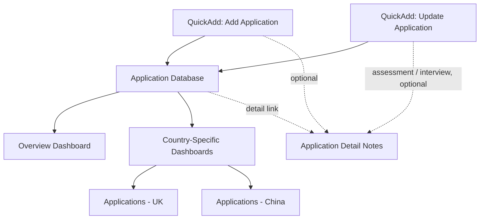

# Job Application Tracker

A standalone Obsidian community plugin for tracking applications in a central Markdown database. **QuickAdd and Dataview are not required for the plugin.** The original script/template workflow remains available below.

## Install the plugin

Until accepted into the community directory, install manually:

1. Download `main.js`, `manifest.json`, and `styles.css` from [GitHub Releases](https://github.com/DGracy/obsidian-job-application-system/releases).
2. Place them in `<vault>/.obsidian/plugins/job-application-tracker/`.
3. Reload Obsidian and enable **Job Application Tracker** in Settings → Community plugins.
4. Use the briefcase ribbon icon or the command **Job Application Tracker: Add application**.
5. Open **Job Application Tracker: Open dashboard / update application** to search, filter, and update applications.

Settings let you choose the Markdown database file and preparation notes folder. Defaults match the original workflow. Existing records are read without importing, copying, or replacing the database. Initialization happens only when saving an application, not when enabling the plugin. Changing settings does not move existing files.

The new form can save a job description and requirements to an optional preparation note. Enable the preparation-note toggle when adding or updating a role. Dates use `YYYY-MM-DD`; clear the deadline field to remove the old deadline. Exact duplicate market/company/role/application-date entries are rejected. Other markets use an `OTHER` ID prefix.

## Development and validation

Node.js 22 or newer; no npm dependencies are required.

```sh
npm run check
npm run build
npm test
```

`src/plugin.js` uses the Obsidian runtime API. `src/model.js` contains Markdown data operations. `build.js` bundles both into `main.js`; commit the generated file alongside source changes. The release workflow validates the bundle and publishes a GitHub Release only when the manifest version has no existing release. Increment `manifest.json`, `package.json`, and `versions.json` for subsequent releases.

Automated checks cover the data model and mocked plugin loading. Real Obsidian desktop/mobile interface testing is still required. `isDesktopOnly: false` indicates that the implementation avoids desktop-only APIs; it does not claim completed mobile testing. Back up your database before first use.

No telemetry, network requests, or external services are used by the plugin. Application data stays in your vault. Original fictional examples remain unchanged.

---

## Original QuickAdd / Dataview workflow

# Job Application Tracker for Obsidian

A metadata-driven job application workflow built with **Obsidian**, **QuickAdd**, **Dataview**, and **JavaScript**.

The system is designed for high-volume job application tracking without creating a separate note for every application. A central application database stores structured metadata and recruitment status, while dedicated detail notes are created only for high-priority roles, assessments, interviews, or applications that require deeper preparation.

## What it does

- Unified application entry workflow with country-specific fields, demonstrated for the UK and China
- Stable application IDs for reliable updates
- Duplicate-application warning
- Recruitment-stage and deadline tracking
- Automatic process-history logging
- Optional application detail pages
- Automatic detail-page creation when an application reaches assessment/interview stages
- Priority, career-track, source, sponsorship, and CV-version metadata
- Real-time overview and country-specific dashboards powered by Dataview
- Separation between structured tracking data and deeper application research

## Architecture



The Application Database is the single source of truth for status and deadlines.

The country-specific dashboards are filtered views built on top of the same data model. The UK and China dashboards in this repository are example implementations, and the same structure can be extended to other countries or regions.

Application detail notes are optional and deliberately do **not** duplicate live recruitment status.

## Repository layout

```text
03 Work/
├── Application Database.md
└── Job Search/
    ├── 00 Dashboard/
    │   ├── Overview.md
    │   ├── Applications - UK.md
    │   └── Applications - China.md
    ├── 01 Applications/
    └── 02 Scripts/
        ├── add-application.js
        └── update-application.js
```

All application data in this repository is fictional demo data.

## Requirements

Install these Obsidian community plugins:

- **QuickAdd** — runs the add/update JavaScript workflows
- **Dataview** — renders dashboards and KPI views

Dataview JavaScript queries must be enabled for the Overview dashboard.

## Setup

1. Copy `example-vault/03 Work/` into your Obsidian vault, or reproduce the same folder structure.
2. In QuickAdd, create a Macro/User Script command for:
   - `03 Work/Job Search/02 Scripts/add-application.js`
   - `03 Work/Job Search/02 Scripts/update-application.js`
3. Open `03 Work/Job Search/00 Dashboard/Overview.md`.
4. Replace the fictional records in `03 Work/Application Database.md` with your own data.

The default script paths are intentionally centralized at the top of each script so they can be changed if your vault uses a different folder structure.

## Core data model

Each application has stable parent-level metadata:

```markdown
- **Northstar Analytics — Graduate Data Analyst**
  [id:: UK-20260910-01]
  [country:: UK]
  [company:: Northstar Analytics]
  [role:: Graduate Data Analyst]
  [type:: Graduate Scheme]
  [sponsor:: Unknown]
  [source:: Company Website]
  [applied:: 2026-09-10]
  [track:: Data / Analytics]
  [priority:: High]
  [cv_version:: Data]
  [detail:: [[03 Work/Job Search/01 Applications/2026-09-10 - Northstar Analytics - Graduate Data Analyst]]]
    - 🔄 [status:: Online Test] [deadline:: 2026-09-28]
```

Dynamic recruitment information lives on the child status row. This makes status updates safe while keeping the parent metadata stable.

See [`docs/data-model.md`](docs/data-model.md) for the complete schema.

## Design Principles

### Central database instead of one note per application

High-volume job searching can generate dozens of low-value notes. The Application Database keeps entry and scanning fast while remaining queryable through Dataview.

### Selective detail notes

A dedicated note is created only when deeper preparation is useful. This keeps the vault small and separates operational tracking from research and interview preparation.

### Stable application IDs

Updates target an application ID rather than relying on company + role text. This avoids ambiguity when the same employer or role is applied to more than once.

### Status history without duplicating state

The current status is stored once, while each change is appended to the process history for traceability.

## Privacy

Do not publish your live application log without reviewing it first. Real job-search data may contain recruiter details, application URLs, candidate IDs, private notes, or commercially sensitive information.

This repository intentionally uses fictional data so the system can be demonstrated without exposing personal application history.

## License

MIT License. See [`LICENSE`](LICENSE).
